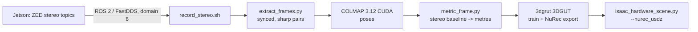

# NuRec real-to-sim from the Jetson stereo camera

Reconstruct the real scene (tree, bunches, trunk, ground) as an NVIDIA NuRec
Gaussian volume and render it around the UR10e in Isaac Sim 5.1.



## Installed on this workstation

| Component | Location |
| --- | --- |
| 3dgrut (NVIDIA 3DGRUT/3DGUT, NuRec exporter) | `~/3dgrut`, venv `~/3dgrut/.venv` (torch 2.6 + system CUDA 12.4, sm_89) |
| COLMAP 3.12.6 with CUDA | conda env `colmap` (`~/miniconda3/envs/colmap/bin/colmap`) |
| Isaac Sim 5.1 (renders NuRec volumes natively) | conda env `env_isaaclab` |

Isaac Sim 5.x only reads the NuRec USDZ format, so `reconstruct.sh` exports with
`export_usd.format=nurec`. The ParticleField format is for Isaac Sim 6.0.

## 1. Jetson: publish the stereo stream

On the Jetson, run the ZED wrapper with the same DDS settings as this machine:

```bash
export ROS_DOMAIN_ID=6 ROS_LOCALHOST_ONLY=0 RMW_IMPLEMENTATION=rmw_fastrtps_cpp
ros2 launch zed_wrapper zed_camera.launch.py camera_model:=zedxm   # or zedx / zed2i
```

Keep `image_transport` compressed topics available (`.../image_rect_color/compressed`).
Raw 1080p stereo is about 180 MB/s, which is more than 1 GbE carries. Both hosts must be on
the same subnet with multicast allowed. From this machine, check that the topics are visible:

```bash
source isaac/nurec/jetson_ros_env.sh && ros2 topic list | grep -E "left|right"
```

## 2. Record

```bash
isaac/nurec/record_stereo.sh ~/nurec_data/bags/palm_row3
```

Left and right image and `camera_info` topics are detected automatically, and `/compressed`
is preferred. To choose them yourself, set `LEFT_IMAGE=... RIGHT_IMAGE=... LEFT_INFO=... RIGHT_INFO=...`.

Capture tips:
- Walk slowly, keep about 70% overlap between views, and circle the tree at two or three heights.
- Lock exposure if you can. Direct sun and moving leaves (wind) show up as floaters.
- Start the recording with the camera in a known pose relative to the robot base, such as
  mounted on the robot or on a tripod at a measured spot. That first pose defines the
  reconstruction frame.

## 3. Reconstruct

```bash
isaac/nurec/reconstruct.sh ~/nurec_data/bags/palm_row3 ~/nurec_data/scenes/palm_row3
# rerun a later stage:        ... --from colmap | metric | train
# pass 3dgrut overrides:      ... n_iterations=15000
# env knobs:                  FPS=2 (pairs per second kept)  WIDTH=1280 (resize)
```

Output: `SCENE/scene_nurec.usdz`. Its frame is the **first left camera**, with ROS body
axes (x forward, y left, z up), in **metres**. Scale comes from the stereo baseline in the
right `CameraInfo` P matrix. `metric_frame.py` drops stereo pairs whose baseline or relative
rotation disagrees (a misregistered image) and warns if more than 20% are dropped.
For the wrist camera, set `MASK_BOTTOM=0.2` so the gripper fingers are ignored.

## 4. Load in Isaac Sim

```bash
unset CONDA_SHLVL
~/miniconda3/envs/env_isaaclab/bin/python isaac/isaac_hardware_scene.py --enable_cameras \
    --nurec_usdz ~/nurec_data/scenes/palm_row3/scene_nurec.usdz \
    --nurec_pose X Y Z QW QX QY QZ
```

`--enable_cameras` is required because the scene contains a camera sensor.
`--nurec_pose` is the world pose of the anchor left camera, in ROS body axes. For the wrist
camera, compute it from the `/tf` recorded in the bag (hand-eye calibration included):

```bash
cd isaac/nurec && source jetson_ros_env.sh
$NUREC_ROS_PYTHON nurec_pose_from_bag.py ~/nurec_data/bags/palm_row3 ~/nurec_data/scenes/palm_row3
```

The default ground plane stays as an invisible collider. The NuRec volume is visual only.

## Verified

Tested on a synthetic ray-traced stereo bag (known room, 0.12 m baseline, 3 m camera path):
all 108 images registered, stereo baseline spread 1%, camera-path error 1.9 cm mean and
3.0 cm max against ground truth. A 5k-iteration 3DGUT run took 35 s on the RTX 5000 Ada
and produced a Z-up, metre-scale NuRec USDZ.

## 5. Live: simulated wrist camera + date detector

Isaac mirrors the real arm (existing digital-twin bridge). A camera on `tool0`, mounted with
the hand-eye transform from the robot's TF, renders the NuRec scene and streams JPEGs over
localhost UDP. A separate viewer runs the date detector on them, so ultralytics stays out of
the Isaac environment.

```bash
# values for both flags:
cd isaac/nurec && source jetson_ros_env.sh
$NUREC_ROS_PYTHON nurec_pose_from_bag.py ~/nurec_data/bags/palm2 ~/nurec_data/scenes/palm2

# terminal 1, either
#   sim only (no robot/Jetson): replay the arm motion recorded in the bag
cd isaac/nurec && source jetson_ros_env.sh && $NUREC_ROS_PYTHON replay_bag_joints.py ~/nurec_data/bags/palm2 --loop
#   or physical twin (Jetson: "Physical robot + Isaac digital twin", discovery server on this PC)
ros2 launch ur10e_curobo isaac_sim_mirror.launch.py joint_state_source:=ros publish_fake_vision:=false

# terminal 2: Isaac with NuRec and the wrist stream
bin/launch_isaac_gpu --nurec_usdz ~/nurec_data/scenes/palm2/scene_nurec.usdz \
    --nurec_pose ... --wrist_camera_extrinsic ... --wrist_stream_port 55010

# terminal 3: live detector window (q to quit, --record out.mp4 to save)
~/nurec_data/yolo_venv/bin/python isaac/nurec/live_detector.py --port 55010
```

To drive the sim arm yourself instead of replaying (don't run both), start from the recording's
first pose and jog with the keyboard in the detector window:

```bash
cd isaac/nurec && source jetson_ros_env.sh
$NUREC_ROS_PYTHON replay_bag_joints.py ~/nurec_data/bags/palm3 --print_start   # prints --start_joints ...
~/nurec_data/yolo_venv/bin/python live_detector.py --port 55010 --jog --start_joints ...
```

Keys: `a/z s/x d/c f/v g/b h/n` jog joints 1–6 (+/−), `]`/`[` double/halve the step (default 1°),
`r` returns to the start pose, `q` quits. Views far from the recorded camera path show
unreconstructed (white, hazy) regions.

`replay_bag_joints.py` recovers arm joints from the bag's `/tf` using the robot URDF, saved as
`BAG/robot_description.urdf` (from the Jetson: `ros2 topic echo --once --qos-durability
transient_local --field data /robot_description --full-length`, minus the trailing `---`).

Take `--wrist_camera_extrinsic` from the recorded TF, not from `calibration_profiles/*.yaml`:
the Jetson's active hand-eye calibration can be newer than the copies in this repo.

## 6. Detachable dates

Turn the dates in a trained map into individual rigid bodies that a gripper can pull off.

```bash
S=~/nurec_data/scenes/palm3
# 1. find dates in every frame (FastSAM masks filtered by shape and by the date detector's colour)
~/nurec_data/yolo_venv/bin/python isaac/nurec/detect_dates.py $S --method fastsam
# 2. locate them in 3D by multi-view voting over the Gaussians (+ date_overlay_*.jpg previews)
(cd ~/3dgrut && source .venv/bin/activate && python ~/manipulatorsdatepalm/isaac/nurec/localize_dates.py $S --min_ratio 0.2)
# 3. cut them out of the map (drop false positives seen in the overlays with --exclude)
(cd ~/3dgrut && source .venv/bin/activate && python ~/manipulatorsdatepalm/isaac/nurec/split_dates.py $S --exclude 14 16)
# 4. photo-texture a mesh per date from the real frames
/usr/bin/python3 isaac/nurec/texture_dates.py $S
# 5. run the scene with the date-free tree + the dates
bin/launch_isaac_gpu --nurec_usdz $S/split/tree_nurec.usdz --nurec_dates $S/split/dates_physics.json \
    --nurec_pose ... [--date_break_force 5.0 --date_mass 0.01] [--wrist_stream_port ...]
```

Each date is a rigid body (capsule collider along its long axis) held by a fixed joint with
`physics:breakForce`; pulling harder than that detaches it and it falls. Check the threshold with

```bash
~/miniconda3/envs/env_isaaclab/bin/python isaac/nurec/date_pull_test.py $S/split/dates_physics.json \
    --nurec_pose ... --break_force 5 --headless     # palm3: 11/11 dates detach within 10% of 2, 5 and 10 N
```

Twist-off (`breakTorque`) is effectively disabled: in this PhysX it trips at 0.2-0.5 N of pull for a
0.5 N m limit, which does not correspond to the date geometry, so it is left uncalibrated.
Dates ignore each other's collisions but hit the gripper and the ground.

The dates are rendered as photo-textured, unlit meshes, not as NuRec volumes: Isaac Sim 5.1
composites NuRec volumes per volume, so the tree volume (which always contains the camera)
hides every other NuRec volume. Meshes composite with NuRec by depth. The per-date NuRec
assets are still exported (`date_XX.usdz`) for a future Isaac Sim with per-Gaussian sorting.

### Scripted pick (grasp physics check)

`date_pick_test.py` drives the UR10e with differential IK (no planner) so the fingertip grasp point
reaches a date along a horizontal approach from the robot, closes the Delto hand over 1.5 s, pulls
back 15 cm, and reports whether the date detached and stayed in the hand, the gripper contact
forces, and any neighbouring dates knocked off:

```bash
~/miniconda3/envs/env_isaaclab/bin/python isaac/nurec/date_pick_test.py $S/split/dates_physics.json \
    --nurec_pose ... --date 6 --headless
```

palm3, recorded base position, 5 N stems: the front dates 06 and 04 are picked (detached, in hand,
~100-120 N total hand contact). Dates 00, 08 and 13 sit behind others; the straight approach knocks
the dates in front off and loses the target, so outer dates have to be harvested first.

Harvest the whole bunch (nearest the base first; picked dates are carried aside and released)
and record a video with the wrist detection view next to an overview camera:

```bash
~/miniconda3/envs/env_isaaclab/bin/python isaac/nurec/date_pick_test.py $S/split/dates_physics.json \
    --nurec_pose ... --harvest_all --record $S/harvest_video --wrist_camera_extrinsic ... --headless
~/nurec_data/yolo_venv/bin/python isaac/nurec/compose_harvest_video.py $S/harvest_video $S/harvest.mp4
```

palm3: 5 of 11 dates picked (06, 07, 04, 09, 13); 2 detached but slipped out, 4 were knocked
off by earlier picks. Recording renders ~2 frames/s (the tree is heavy); 1460 frames = 49 s.

The robot's gravity is disabled in this test (the UR controller compensates it; plain PD joints
sag ~10 cm at the date). The gripper closes gradually: jumping the target to "closed" or capping
the arm speed (which leaves the wrist roll short) knocks the 10 g date off before it is held.

## 7. Dynamic bunch (stalk and strands move)

The stalk and strands become sprung chains and the dates hang on them, so the bunch sways
when pushed and gives when a date is pulled.

```bash
S=~/nurec_data/scenes/palm3
# after section 6 (dates split and textured):
(cd ~/3dgrut && source .venv/bin/activate && \
  python ~/manipulatorsdatepalm/isaac/nurec/bunch_skeleton.py $S --export)   # skeleton + tree_nobunch_nurec.usdz
~/miniconda3/envs/env_isaaclab/bin/python isaac/nurec/bunch_test.py $S/split --nurec_pose ... --headless
~/miniconda3/envs/env_isaaclab/bin/python isaac/nurec/date_pick_test.py $S/split/dates_physics.json \
    --nurec_pose ... --harvest_all --bunch [--record DIR --wrist_camera_extrinsic ...] --headless
```

- `bunch_skeleton.py` selects tan Gaussians around the dates and builds a level-set skeleton from
  the stalk root (palm3: 264 nodes, 43 strand tips, 7.1 m), then carves those strands out of the
  tree splat.
- `nurec_bunch.py` groups the skeleton into ~6 cm sections (123 rigid bodies); each carries its
  fine tube visuals and capsule colliders, so strands keep their curves. Sections hang from their
  parents on sprung joints preloaded to the captured shape; strand bodies have no gravity (real
  strands hold their shape by wood stiffness); dates hang from their section on the 5 N stems.

palm3 (`bunch_test.py`): 5 s of physics in 3 s wall time on the GPU. Section bodies carry 6 /s
linear and angular damping (`body_damping`; joint damping above critical diverges, body damping does
not).

Realism of the strands and stalks (`stalk_test.py`: rest, a held finger push on the date nearest the
robot, and a pull, at the harvest scene's 120 Hz):

| strands | stalk | drift at rest | steady push |
|---|---|---|---|
| sag 0.01 rad/joint, min 0.3 N m/rad, 64 iterations (before) | rigid pin at the date centre | 7.9 cm median | 62 cm/N |
| sag 0.0005 rad, min 4 N m/rad, 255 iterations (now) | sprung ball joint at the date top | 1.7 cm | 7.6 cm/N |

The give was mostly solver softness, not the springs: 4x stiffer springs at 64 position iterations
only went from 62 to 41 cm/N, and 20x stiffer at 64 diverged (1.7 m/s jitter); 255 iterations let
the 20x springs hold. Acceleration drives (`drive_frequency`) sagged more and are off by default. Each
date now hangs from the top of its long axis on a 0.1 N m/rad spring (`stalk_stiffness`; 0 = the
old rigid pin), so a finger push swings it ~0.5 cm and it still comes off at the break force.
Scripted harvest of the whole bunch (`date_pick_test.py --bunch --harvest_all`): 8 of 11 picked
(4 of 11 before), 3 knocked off by neighbouring picks.

In `date_pick_test.py` with `--bunch` the robot does not collide with the strands, only with the
dates: closing on a date the hand otherwise trapped neighbouring strands, dragged the cluster and
flung the date when they sprang back. Dates have friction 1.0 (combine "max"; PhysX's default 0.5
let detached dates slide out). Given `--wrist_camera_extrinsic`, the tool roll keeps the wrist
camera image upright (`--roll_offset` adds to it). Recording colours the asset's all-white robot
(grey arm, dark Delto hand) and the overview camera follows the hand from ~0.45 m.
Harvest: 4 of 11 picked (`harvest_palm3_v3.mp4`). The date and strand meshes take their photo
colours from a palette texture (`PhotoPalette`); the earlier emissive material read a custom
per-vertex primvar and rendered them solid black in some runs. Limits: the strands are softer than real ones (a pull drags a strand far
before the stem snaps) and stiffer settings make the jointed solver unstable; per-joint springs
stiffer than ~1 N m/rad or damping above critical diverge. A single PhysX articulation (the right
model for chains) was far too slow at 264 links on both CPU and GPU.

## 8. Full harvest cycle: cuRobo on the Jetson, robot and palm in Isaac

The real control node (`ur10e_curobo main`: cuRobo planning, goal multi, grasp, lift, drop) runs on
the Jetson unchanged; this PC stands in for the UR driver, the Delto driver and the ZED date
detector, over the same ROS topics (`ur10e_curobo/docs/ISAAC_SIM_HARDWARE_MIRROR.md`).

```bash
# PC (discovery server, ROS mirror, sim_vision.py, Isaac palm3 scene; logs in /tmp/isaac_harvest_logs)
bin/launch_isaac_harvest_pc            # add --headless for no window
# Jetson (curobo-v2; stop the UR/Delto drivers and the vision node first)
launch_isaac_jetson environment:=lab
# Then, from either machine (ROS_DISCOVERY_SERVER=10.76.154.75:11811, ROS_DOMAIN_ID=6):
ros2 topic pub --once /ui_command std_msgs/String "data: 'set_debug_preview false'"
ros2 topic pub --once /ui_command std_msgs/String "data: 'subscribe_multi 3'"
ros2 topic pub --once /ui_command std_msgs/String "data: 'execute'"
```

- Robot: `isaac/build_ur10e_delto_usd.py` converts the robot's own `/robot_description` (palm3
  bag) to `~/isaac_ws/ur10e_delto/ur10e_delto.usd`. The Isaac Lab `ur10_tesollo.usd` is a UR10
  (shoulder 0.127 m, not 0.181 m): its tool0 was 7 cm off what cuRobo plans for the UR10e at the
  lab home; the new asset matches UR10e kinematics to 4 mm.
- Vision: `isaac_hardware_scene.py` writes the wrist RGB-D frame and camera pose (from tool0 and
  the mount) to `/dev/shm`; `sim_vision.py` runs the robot's YOLO segmentation model, takes the
  front-surface point of each date mask as the real node does, tracks dates for 2 s, and returns
  them in base_link (static dates: 4-10 mm from their true centres). The bridge publishes
  `/vision/all_fruit_poses`, `/external_goal_pose` (honouring `/exclude_fruit_positions`),
  `/fruit_radius` and `/trunk_position`, and no fallback fruit once wrist vision is active.
- Differences from the robot: NuRec splats write no depth, so the trunk comes from the bunch
  skeleton root (4 cm behind it) instead of the camera. At the previous lab home the wrist camera
  was rolled ~90 deg and the detector, trained on upright images, found nothing; `sim_vision.py`
  turns the image upright (nearest quarter turn) before detecting. The real vision node does not.
- Start pose: the lab home re-taught on 2026-09-16 (palm3 was recorded in the lab), close to the
  palm3 recording's start pose; the bridge runs with `UR10E_ENVIRONMENT=lab` so its initial
  command matches.
